# Sessionmux — switch between multiple Claude Desktop accounts on Windows and Mac
> Sessionmux is an independent, unofficial open-source project. It is not affiliated with, endorsed by or sponsored by Anthropic, PBC. Claude is a trademark of Anthropic, PBC.

<div align="center">

<a href="https://github.com/joyal-droid/sessionmux/releases/latest/download/Sessionmux-Setup.exe">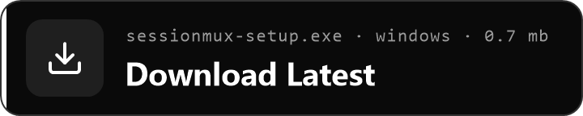</a>

Windows 10 and 11, 64-bit · about 0.7 MB · installs for your user, no administrator rights

If Windows shows "Windows protected your PC", choose **More info**, then **Run anyway** ([why](#why-does-windows-show-a-smartscreen-warning)).

<a href="https://github.com/joyal-droid/sessionmux/releases/download/v1.1.0-preview.2/Sessionmux-macOS.dmg">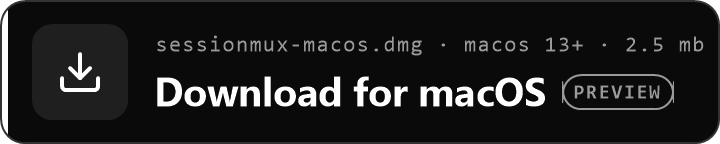</a>

**Preview** · macOS 13 or later · one app for Apple silicon and Intel · [release page](https://github.com/joyal-droid/sessionmux/releases/tag/v1.1.0-preview.2)

Built and tested automatically, [not yet verified on a Mac](#not-yet-verified-on-a-mac). macOS asks you to confirm it once with **Open Anyway** ([how](#install-on-macos)).

</div>

Sessionmux is a multi-account switcher for Claude Desktop. It lets you run two or more Claude
accounts side by side, each in its own window with its own sign-in, and switch Claude accounts
without logging out, from a floating button, the tray or menu bar icon, or a hotkey. It can also
move Claude Code sessions between accounts, hand a session over when an account hits its plan
limit, let you approve a waiting session's next step from its panel, and make Google and Apple
sign-in work for a second Claude account. It is a small native app, free and open source: 1.7 MB
on Windows, and a [preview for macOS](#macos-preview) built from the same code.

[](https://github.com/joyal-droid/sessionmux/actions/workflows/ci.yml) [](https://github.com/joyal-droid/sessionmux/releases/latest) [](https://github.com/joyal-droid/sessionmux/releases) [](https://github.com/joyal-droid/sessionmux/blob/main/LICENSE) [-0078D6)](#install) [](#roadmap)

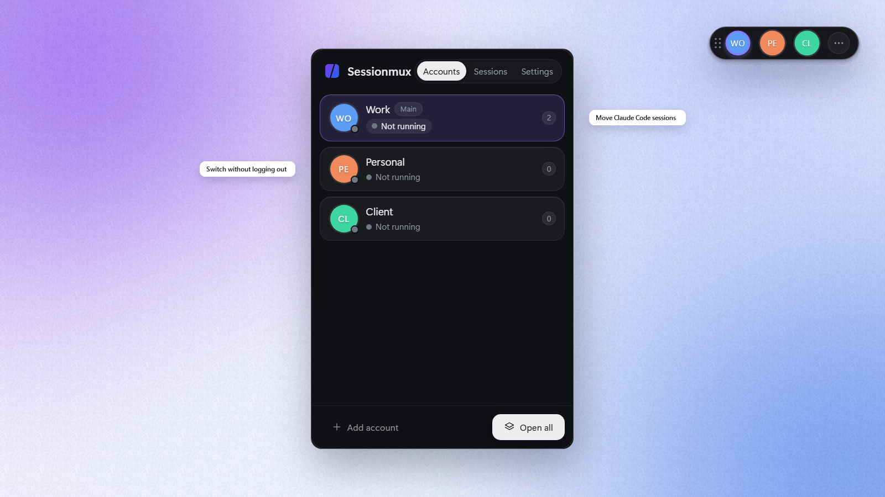

⭐ If Sessionmux saves you a log-out, star the repo — it helps others find it.

## See it in action

| Switch accounts from the floating button | Move a session to another account |
| --- | --- |
| 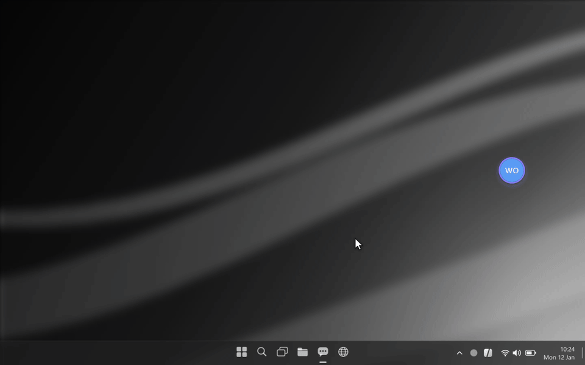 | 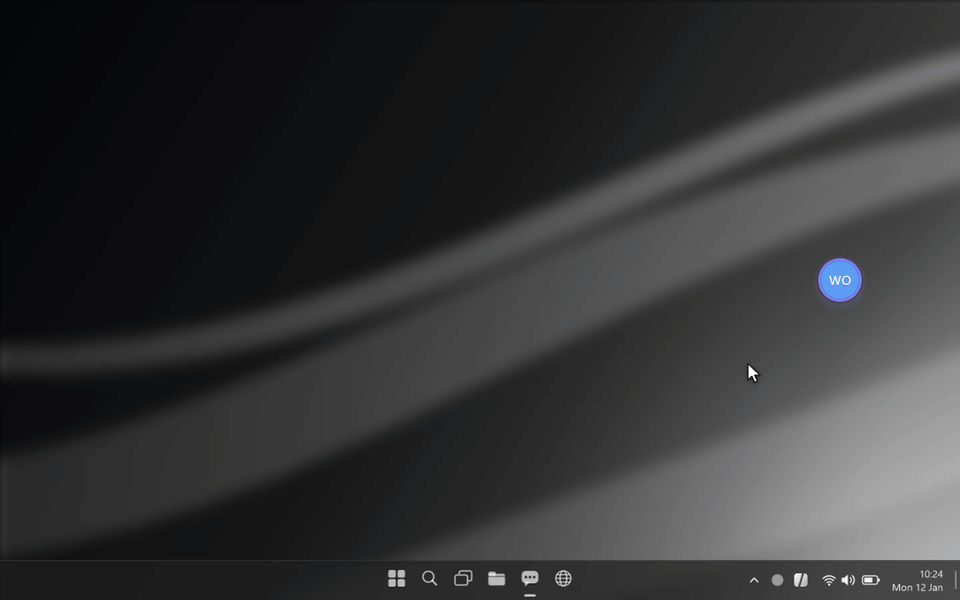 |
| **Approve a waiting step** | **Hand over a session at the limit** |
| 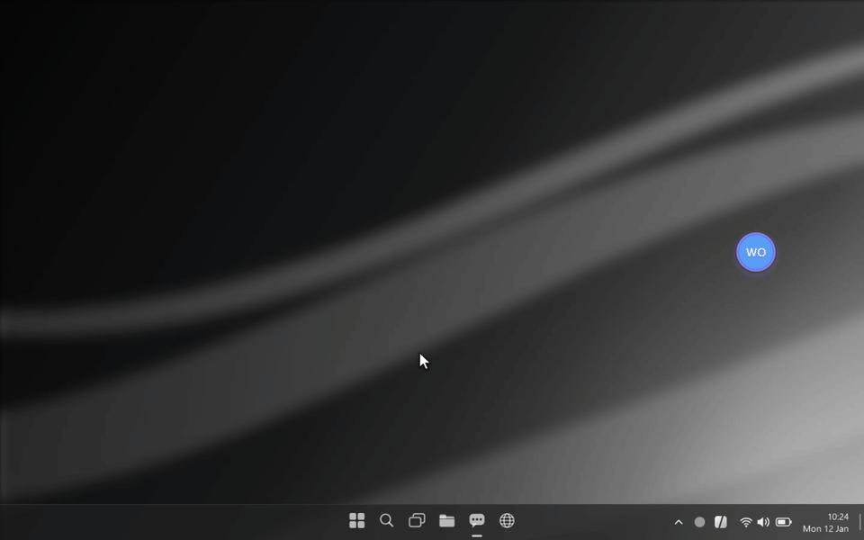 | 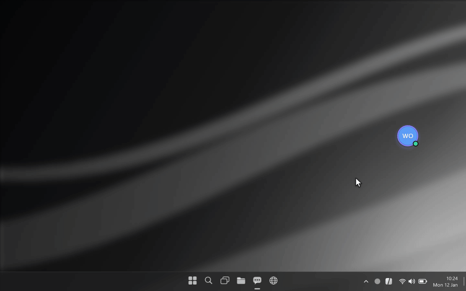 |

## Why Sessionmux

Claude Desktop runs one account at a time. Switching means logging out and back in, which closes
the window you were working in and hides the Code tab's sessions of the account you left. People
who keep separate personal, work and client accounts end up doing this several times a day.

Sessionmux does this instead:

- **Keeps every account signed in.** Each extra account gets its own Claude data folder, so all of
  them can be open at the same time and none of them has to log out.
- **Switches in one click.** Click an account on the floating button or in the panel and its window
  comes to the front, or starts if it is closed.
- **Moves your work with you.** A Code-tab session can be moved or copied to another account,
  transcript included, and continued there.

## Features

The features are the same on Windows and macOS; where the Mac does something differently, it is
said in brackets.

- **Switch Claude Desktop accounts** from a floating button that stays above your windows: either
  a round icon in the active account's colour or a mini tray with your first three accounts. It
  snaps to the screen edge and remembers its position.
- **Open, focus or close any account** with one click; **Open all** starts every account at once.
- **Move or copy Claude Code sessions between accounts** on the Sessions tab, with the transcript,
  the scratch folder and the project memory, even while the session's tab is open in Claude. A
  closed session's original is removed only after the copy succeeded; the original of a session
  that is still open stays open in its account until you close it there.
- **Hand over a session** to another account, from a session's **…** menu or automatically when
  an account hits its plan limit: Sessionmux copies the session to the next signed-in account that
  is not limited and opens that account's Claude window if it is closed. An open window is never
  closed by an automatic hand-over; restart it to see the session.
- **Approve from the panel.** A Code-tab session that asks for permission shows up at the top of
  the Sessions tab with the tool and a summary of what it wants to do; choose **Allow** or **Deny**
  there, or answer in Claude as usual. Nothing is ever approved without you. Optional and off by
  default (see [Does Sessionmux change my Claude settings?](#does-sessionmux-change-my-claude-settings)).
- **Google and Apple sign-in for extra accounts** through sign-in routing (see
  [Signing in to extra accounts](#signing-in-to-extra-accounts)); e-mail sign-in works as well.
- **Find existing profiles.** `Claude-<name>` folders you created earlier (in `%APPDATA%`, or
  `~/Library/Application Support` on a Mac) are offered under **Found profile folders** and keep
  their sign-in when added.
- **Same sign-in detection.** Two accounts signed in to the same Claude account are both marked.
- **Share MCP servers from Main.** Optionally copies the Main account's MCP server configuration to
  the other accounts whenever it changes.
- **Tray icon and global hotkey** (menu bar icon on a Mac). **Ctrl+Shift+Space** (**⌃⇧Space** on a
  Mac) opens or closes the panel from anywhere; the tray or menu bar menu lists your accounts too.
- **Small and private.** One native process of about 4 MB while idle on Windows, no telemetry and
  no network connections of its own. The panel (WebView2 on Windows, the system's WebKit on a Mac)
  exists only while it is open.
- **Start with Windows** (**Open at login** on a Mac), System / Light / Dark themes, names, colours
  and labels per account.

| On the desktop: mini tray | On the desktop: panel open |
| --- | --- |
| 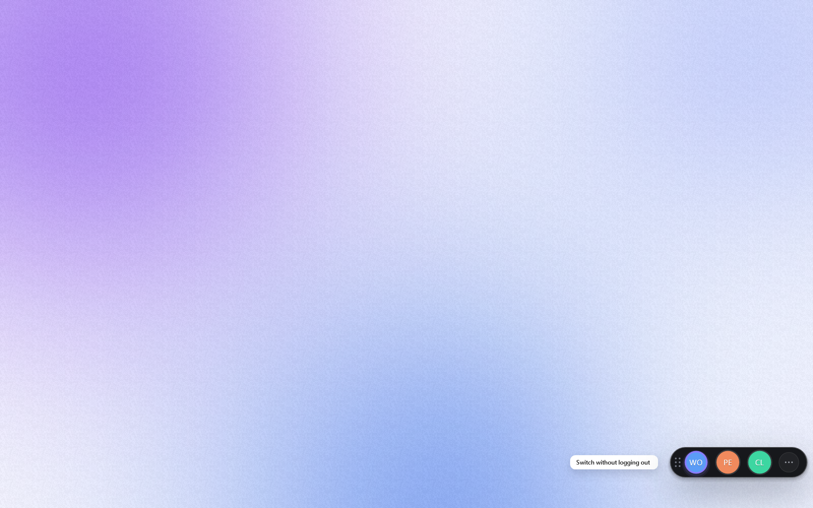 | 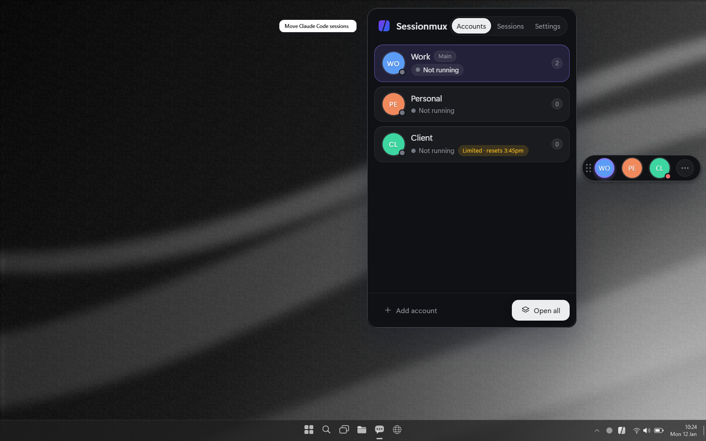 |

| Accounts | Sessions | Settings |
| --- | --- | --- |
| 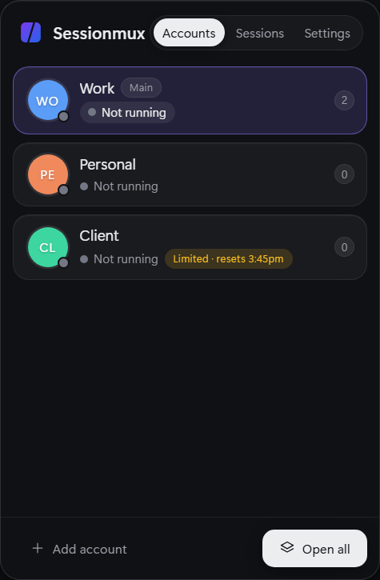 | 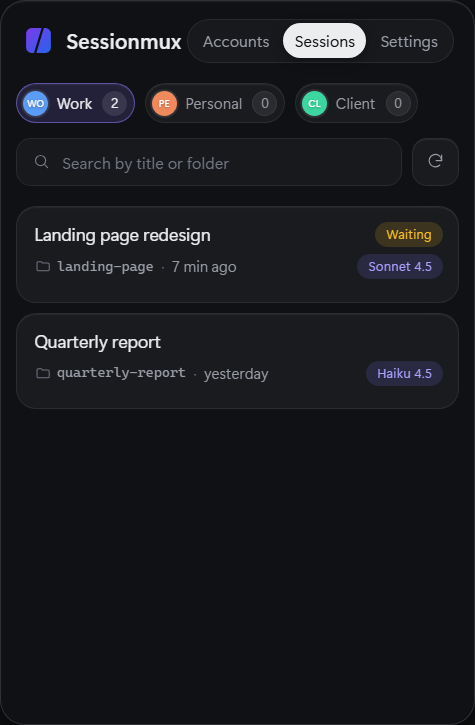 | 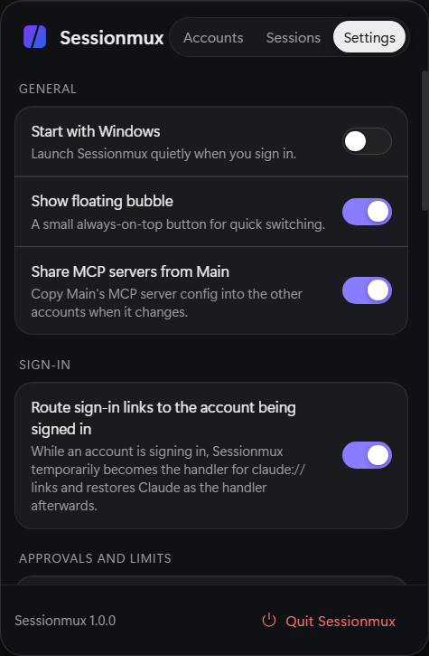 |

| Floating button | Mini tray | Signing in an extra account |
| --- | --- | --- |
|  | 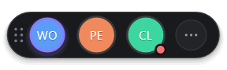 | 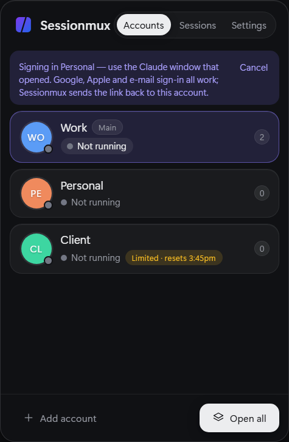 |

The screenshots show the Windows app with demo data in the dark theme. The macOS app has the same
panel and floating button; there are no screenshots from a real Mac yet.

## How it compares

| | Floating switcher | Session move / copy | Sign-in routing for Google / Apple | Footprint | Price | Open source |
| --- | --- | --- | --- | --- | --- | --- |
| **Sessionmux** (Windows 10/11; macOS 13+ as a preview) | Yes: floating button (icon or mini tray), plus tray or menu bar icon and hotkey | Move and copy of Code-tab sessions between accounts | Yes: `claude://` links go to the account that is signing in | Windows: about 4 MB idle, 1.7 MB exe. macOS: not measured on a Mac yet | Free | Yes, CPAL-1.0 |
| **Logging out and back in** (built into Claude Desktop) | No; one account at a time | No; you see the sessions of the signed-in account only | Not needed; one account at a time | None | Free | Not applicable |
| **[claude-desktop-switcher](https://github.com/matsumotory/claude-desktop-switcher)** (macOS) | Menu bar app; a floating button is not documented | Not documented | Not documented | Universal DMG about 7 MB | Not documented | Yes, MIT |
| **[Claude Sessions Pro](https://doubleclaude.com)** (macOS, Windows) | Menu bar (macOS) and tray icon (Windows); a floating button is not documented | Sessions from the main app are copied into a profile when you sign in to it; moving sessions between profiles is not documented | Google and e-mail sign-in documented; Apple not documented | Not documented | $15 one-time, up to 2 computers | No, commercial |

Each row describes only what that project documents publicly: the claude-desktop-switcher README
and the Claude Sessions Pro website and its
[AlternativeTo listing](https://alternativeto.net/software/claude-sessions-pro/about/), as read in
October 2026. Corrections are welcome as an issue or pull request.

## Install

### Install on Windows

**Requirements**

- Windows 10 or 11, 64-bit (x64).
- Claude Desktop, either the Microsoft Store version or the direct installer.
- The Microsoft Edge WebView2 Runtime. It ships with Windows 11 and most Windows 10 PCs; Setup
  tells you if it is missing and links to <https://developer.microsoft.com/microsoft-edge/webview2/>.

**Download**

1. Download [Sessionmux-Setup.exe](https://github.com/joyal-droid/sessionmux/releases/latest/download/Sessionmux-Setup.exe)
   (about 0.7 MB). That link always serves the newest stable release (never a preview); the
   [releases page](https://github.com/joyal-droid/sessionmux/releases/latest) has the same file as
   `Sessionmux-Setup-<version>.exe` next to `SHA256SUMS`.
2. Optionally [verify the download](#verify-your-download).
3. Run the setup file. It installs for your Windows user only, without administrator rights, into
   `%LOCALAPPDATA%\Programs\Sessionmux`, adds Start menu and desktop shortcuts and starts Sessionmux.

**SmartScreen.** Windows SmartScreen trusts files by their download history and by code signing.
A new open-source build that is not signed yet has neither, so Windows may show "Windows protected
your PC". Choose **More info**, check that the file name matches what you downloaded (and the
SHA-256, if you like), then **Run anyway**.

**Upgrading.** Run a newer setup file. It closes the running Sessionmux first and keeps your
accounts and settings.

**winget.** A `winget` package (`Sessionmux.Sessionmux`) is planned after the first release.

### macOS (preview)

The macOS app is a preview. It has the full feature set of the Windows app and passes the automated
checks on GitHub's macOS machines (Apple silicon and Intel, macOS 15 and 26), but nobody has tried
it on a real Mac yet; see [Not yet verified on a Mac](#not-yet-verified-on-a-mac). It is built from
the [`macos` branch](https://github.com/joyal-droid/sessionmux/tree/macos) and published as the
pre-release [v1.1.0-preview.2](https://github.com/joyal-droid/sessionmux/releases/tag/v1.1.0-preview.2),
next to a Windows installer of the same version. Once it has been checked on a real Mac, it moves
into the main branch and the normal releases, and the preview label goes.

**What is in the preview**

- Everything listed under [Features](#features): the floating button, the panel, accounts, Open
  all, sessions (move, copy, hand over, approve from the panel), plan limits, found profile
  folders, MCP sharing and sign-in routing.
- A menu bar icon instead of the tray icon: click it to show or hide the panel, Control-click or
  right-click it for the menu. Sessionmux has no Dock icon.
- **⌃⇧Space** opens the panel; the panel uses **⌘1**, **⌘2**, **⌘3** for its tabs and **⌥↑ / ⌥↓**
  to reorder accounts.
- **Open at login**, **Show in Finder**, and in Settings **Remove Sessionmux's changes** (there is
  no uninstaller on a Mac) and **Bring minimised Claude windows to the front** (off by default).
- Extra accounts live in `~/Library/Application Support/Claude-<name>`, next to the Main account's
  `~/Library/Application Support/Claude`.
- One app, `Sessionmux.app`, with one universal program inside for Apple silicon and Intel. No
  installer, no helper apps, nothing else to install: the panel uses the WebKit that is part of
  macOS.

**Requirements**

- macOS 13 Ventura or later, on Apple silicon or Intel.
- Claude Desktop for Mac, in `/Applications` or `~/Applications`.
- Cowork needs Apple silicon; Claude does not offer it on Intel Macs.

#### Install on macOS

1. Download [Sessionmux-macOS.dmg](https://github.com/joyal-droid/sessionmux/releases/download/v1.1.0-preview.2/Sessionmux-macOS.dmg)
   from the [pre-release](https://github.com/joyal-droid/sessionmux/releases/tag/v1.1.0-preview.2)
   (a `.zip` of the same app is there too) and optionally [verify it](#verify-your-download).
2. Open the disk image. In the window that opens, drag **Sessionmux** onto **Applications**, then
   eject the disk image. Run the app from Applications, not from the disk image: approval from the
   panel, Open at login and sign-in routing need the app to stay where it is.
3. Open Sessionmux from Applications. The app is signed ad hoc, without an Apple Developer ID, and
   not notarized, so macOS says it cannot check it for malicious software. Confirm it once per
   version:
   - **macOS 15 and later:** choose **Done**, open **System Settings > Privacy & Security**, scroll
     down to **Security** and choose **Open Anyway** next to the line about Sessionmux, then
     confirm with **Open Anyway** and your password. Right-click > **Open** no longer skips this
     on macOS 15.
   - **macOS 13 and 14:** Control-click Sessionmux in Applications, choose **Open**, then **Open**
     again.

   If macOS instead says Sessionmux "is damaged and can't be opened", run
   `xattr -dr com.apple.quarantine /Applications/Sessionmux.app` in Terminal and open it again.

**Permissions macOS may ask for.** The core features (floating button, menu bar icon, accounts,
sessions, approvals) need no permission at all. Sessionmux never asks for Input Monitoring, Screen
Recording, Full Disk Access or notifications.

- **Automation** ("Sessionmux wants access to control Claude"): asked once, the first time sign-in
  routing passes a sign-in link to an extra account's Claude window. Without it, sign in with an
  e-mail code instead.
- **Accessibility**: only if you turn on **Bring minimised Claude windows to the front** in
  Settings. macOS does not let an app un-minimise another app's window or fetch it from another
  Space without it; Sessionmux offers the switch when bringing a window forward did not work.
- **Login Items**: turning on **Open at login** shows a "Background Items Added" notice. If
  Settings says so, allow Sessionmux in **System Settings > General > Login Items**.

Because the app is signed ad hoc, macOS ties the Automation and Accessibility grants (and possibly
the login item) to the exact build, so after an update you may have to give them again.

**Sign-in routing on macOS 26.4 and later.** From macOS 26.4 on, macOS asks "Use / Keep" every time
an app changes which app opens `claude://` links, so Google or Apple sign-in for an extra account
would bring up two or three of these questions. Sign-in routing is therefore off by default there
and opt-in in **Settings > Sign-in**; signing in with an e-mail code needs none of it. On macOS 13
to 26.3 routing is on by default, and the automated checks on macOS 15 saw no question there.

**One copy per account.** On a Mac, starting Claude a second time on an account that is already
open would run a second copy beside the first instead of switching to it. Sessionmux therefore
never starts an account that is already open: it brings the open window forward instead.

#### Upgrading and uninstalling on macOS

**Upgrading.** Quit Sessionmux from its menu bar icon, then replace `Sessionmux.app` in
Applications with the new one. Your accounts and settings stay in
`~/Library/Application Support/Sessionmux`. macOS asks you to confirm the new version once, as
above.

**Uninstalling.** In **Settings**, choose **Remove Sessionmux's changes** (it removes the hook
entries, gives `claude://` links back to Claude and turns off Open at login), then quit Sessionmux
and move it to the Trash. Without the panel, Terminal can remove the hook entries with
`/Applications/Sessionmux.app/Contents/MacOS/Sessionmux --remove-hooks` and end a sign-in that is
still under way with `/Applications/Sessionmux.app/Contents/MacOS/Sessionmux --end-relay`. These
commands leave Open at login alone: turn it off in Settings first, or remove Sessionmux from
**System Settings > General > Login Items** (and delete
`~/Library/LaunchAgents/io.github.joyal-droid.sessionmux.plist` if it exists). If you refused
earlier to give the links back to Claude, `--end-relay` leaves them as they are; use **Remove
Sessionmux's changes** in the panel instead.
Your accounts' Claude data folders and `~/Library/Application Support/Sessionmux` are kept; delete
them yourself if you no longer need them.

#### Not yet verified on a Mac

These parts have not been tried on a real Mac yet. Reports are welcome as an
[issue](https://github.com/joyal-droid/sessionmux/issues/new/choose).

- Signing in to an extra account with Google or Apple (sign-in link routing), including the
  "Use / Keep" questions macOS 26.4 and later asks. The automated checks switch the link handler
  to Sessionmux and back on macOS 15, but passing a sign-in link on to the right Claude window has
  not been tried yet. Signing in with an e-mail code is the safe way meanwhile.
- Passing a link to one particular Claude window with an Apple Event: the automated check for it
  is skipped, because GitHub's macOS machines leave the Automation question unanswered.
- Bringing a minimised Claude window, or one in another Space, to the front; whether the
  Accessibility switch is needed for that.
- Open at login, and whether it survives an update.
- The global shortcut on non-US keyboard layouts.
- Two people using Sessionmux on the same Mac at the same time.
- How Sessionmux behaves while Claude updates itself with several accounts open.
- The newest Claude Desktop versions: the automated checks ran with older Claude Desktop builds.
- The look of the floating button and menu bar icon on real displays (the automated checks only
  see images).

### Verify your download

Compare the SHA-256 of the file you downloaded with its line in `SHA256SUMS` on the same release
page.

Windows (PowerShell):

```powershell
Get-FileHash .\Sessionmux-Setup-<version>.exe -Algorithm SHA256
```

macOS (Terminal, in the folder with the disk image and the pre-release's `SHA256SUMS`):

```sh
grep '  Sessionmux-macOS.dmg$' SHA256SUMS | shasum -a 256 -c
```

With the [GitHub CLI](https://cli.github.com) you can also check that the file was built by this
repository's release workflow on GitHub Actions (there is no signing key; GitHub records the build
provenance):

```sh
gh attestation verify Sessionmux-Setup-<version>.exe --repo joyal-droid/sessionmux --signer-workflow joyal-droid/sessionmux/.github/workflows/release.yml
gh attestation verify Sessionmux-macOS.dmg --repo joyal-droid/sessionmux --signer-workflow joyal-droid/sessionmux/.github/workflows/release.yml --source-ref refs/tags/v1.1.0-preview.2
```

[SECURITY.md](SECURITY.md#verifying-a-download) explains both checks and how to rebuild the exe
or the macOS app from source and compare it.

## Quick start

1. **Start Sessionmux.** Your existing Claude Desktop install appears on the **Accounts** tab as
   the **Main** account, and the floating button appears at the edge of the screen.
2. **Add an account.** Click **Add account**, type a name such as "Work", pick a colour and click
   **Add & open**. A new Claude window opens; sign in there with Google, Apple or e-mail (on
   macOS 26.4 and later, with an e-mail code unless you turned sign-in routing on).
3. **Switch.** Click an account on the floating button or in the panel (**Ctrl+Shift+Space**, or
   **⌃⇧Space** on a Mac) to bring its window to the front. To take a session along, open the
   **Sessions** tab, pick the account it is in and choose **Move to** or **Copy to**.

More detail: click a row's **…** menu to rename, recolour, close or remove an account; drag the
handle or press **Alt+↑ / Alt+↓** (**⌥↑ / ⌥↓** on a Mac) to reorder (the mini tray shows the first
three). Settings are under **Settings**: Start with Windows (Open at login on a Mac), Show
floating bubble, Share MCP servers from Main, sign-in routing, Theme, Floating button shape, the
two session options described under [Sessions](#sessions), and on a Mac also Bring minimised
Claude windows to the front and Remove Sessionmux's changes.

## How it works

Every extra account is a separate Claude Desktop data folder, `%APPDATA%\Claude-<name>`, and
Sessionmux starts Claude with `--user-data-dir` pointing at it, so each account keeps its own
sign-in, chats and settings. Sessionmux itself is one Rust process: a Direct2D floating button, a
tray icon, a hotkey and a check of the running Claude windows every 3 seconds. The panel is a
WebView2 page that is created when you open it and destroyed 30 seconds after it closes, which is
why the idle footprint stays around 4 MB.

On a Mac it works the same way with the system's own parts: extra accounts are
`~/Library/Application Support/Claude-<name>` folders, Claude is started through Launch Services
with `--user-data-dir`, the floating button is drawn with Core Graphics, the menu bar icon and the
hotkey are standard AppKit and Carbon features, and the panel is a WebKit view. The hook helpers
talk to the app over a Unix socket that only your macOS user can open. None of this needs a
permission.

A session move copies the session record with new internal IDs, its transcript, its scratch folder
and the project memory to the other account, then removes the original record only if everything
succeeded and the session is not open in Claude. Project folders are never moved or copied. The
optional approval and limit features use Claude Code's own hooks: Claude Code runs
`Sessionmux.exe --approve-hook` or `--notify-hook` (on a Mac, the program inside
`Sessionmux.app`), which pass the event to the running app over a pipe (a socket on a Mac) that
only your user can open. Details: [docs/architecture.md](docs/architecture.md).

## Sessions

The **Sessions** tab lists the Code-tab sessions of each account, with a **Running** badge on the
ones that are open in Claude.

- **Move to and Copy to** copy the session record with new internal IDs, its transcript, its
  scratch folder and the project memory to another account. The target account must be signed in
  and have opened the Code tab once; restart its Claude window to see the session there.
- **Even while the tab is open.** Copy and move also work on a session that is open in Claude.
  Sessionmux copies it as it is at that moment, so anything Claude is still writing will not be in
  the copy. When you move an open session, the original stays open in its account (Claude still
  owns its files) until you close it there; only a closed session is removed from the source, and
  only after the copy succeeded. Deleting a session still needs it closed.
- **Hand over** (in a session's **…** menu) copies the session to another account and shows it
  there. Sessionmux picks the first account in panel order that is signed in, has opened the Code
  tab and has not hit its limit, and opens that account's Claude window if it is closed. Claude
  lists sessions only when it starts, so an open window must restart to show the copy: leave
  the confirm dialog's restart option ticked and Sessionmux restarts it, but only when no
  session is running there at that moment; otherwise the window stays open and you restart it
  when it suits you. If every other account is limited, it tells you when the earliest one
  resets.
- **Automatic hand-over.** With **Hand sessions over automatically when an account hits its limit**
  on, an account that hits its plan limit hands over its most recently active open session: one
  session per limit, and never while that session waits for your approval. It never closes,
  restarts or interrupts a Claude window: it opens the target's window when it is closed, and
  otherwise tells you to restart it to see the session. A limited account shows
  **Limited** with the reset time Claude gave, for example "Limited · resets 5:20pm".
- **Waiting for your approval.** With **Show waiting sessions and approve from Sessionmux** on, a
  permission request from any account appears at the top of the tab: the account, the session, the
  folder, the tool and a summary of what it wants to do, with **Deny**, **Allow** and
  **Open in Claude**. **Allow** becomes clickable only after a short moment and is never the
  default button, so a stray Enter approves nothing. Answering in Claude instead works as before
  and removes the card. Sessions that wait for you are marked **Waiting** or **Needs you**.

Both options are off by default. They rely on hook entries that Sessionmux adds to Claude Code's
settings only when you turn approval on; see
[Does Sessionmux change my Claude settings?](#does-sessionmux-change-my-claude-settings).

## Signing in to extra accounts

Google and Apple sign-in finish in the browser with an "Open Claude" (`claude://`) link, and the
system hands every such link to the Main account. While an account that Sessionmux opened is
waiting to sign in, Sessionmux briefly becomes the handler for `claude://` links and passes each
one to that account's window; a notice with **Cancel** is shown meanwhile. Claude's own handler is
restored as soon as the account is signed in, on cancel, after 15 minutes or when the window
closes; on Windows also when Sessionmux quits, and on a Mac at Sessionmux's next start instead
(quitting never changes the handler there).

On a Mac, Sessionmux passes the link to the account's Claude window with an Apple Event, which is
why macOS asks for Automation once. On macOS 26.4 and later every change of the link handler shows
a "Use / Keep" question, so routing is off by default there; see
[macOS (preview)](#macos-preview).

You can turn this off in **Settings > Sign-in**; extra accounts then sign in with **Continue with
email**. If your browser is already signed in to claude.ai as someone else, sign out there first
or open the sign-in link in a private window. The full design is in
[docs/sign-in-routing.md](docs/sign-in-routing.md).

## Privacy

Sessionmux collects nothing: no telemetry, no analytics, no accounts, and no network connections of
its own, on Windows and on macOS. It reads Claude Desktop's local files only to list your accounts
and sessions and to do what you ask. What it stores and reads, and where, is listed in
[PRIVACY.md](PRIVACY.md). The log is `%APPDATA%\Sessionmux\sessionmux.log` on Windows and
`~/Library/Application Support/Sessionmux/sessionmux.log` on a Mac (kept under 1 MB); attach it
when reporting a problem.

## FAQ

### How do I use two Claude accounts on one PC or Mac?

Install Sessionmux, click **Add account** and sign in to the second account in the window that
opens. Both accounts then run side by side in their own windows, and you switch between them from
the floating button, the tray or menu bar icon, or **Ctrl+Shift+Space** (**⌃⇧Space** on a Mac).
Neither account has to log out.

### Can I move a Claude Code session to another account?

Yes. On the **Sessions** tab, pick the account the session is in and choose **Move to** or
**Copy to**, then the target account, or choose **Hand over** to let Sessionmux pick an account
that is not limited and open its window for you (an open window is restarted only when you allow
it and no session is running there). The session may be open in Claude: Sessionmux
copies it as it is at that moment, and the original of a moved session that is still open stays
open in its account until you close it there. The target account must be signed in and have
opened the Code tab once; restart the target's Claude window to see the session there.

### Does Google sign-in work for a second Claude Desktop account?

Yes, with sign-in routing, which is on by default on Windows and on macOS up to 26.3. Sessionmux
sends the browser's `claude://` link to the account that is signing in instead of the Main
account, and puts Claude's own link handler back afterwards. Apple sign-in works the same way, and
e-mail sign-in needs no routing at all. On macOS 26.4 and later routing is opt-in (see the next
questions), and on macOS it is still [being verified](#not-yet-verified-on-a-mac).

### Is this allowed by Anthropic's terms?

Sessionmux only manages separate Claude accounts that you own, each with its own sign-in, on your
own computer; it does not change how Claude Desktop or your accounts work. You are responsible for
following Anthropic's terms for each of your accounts, for example the
[Consumer Terms](https://www.anthropic.com/legal/consumer-terms) or the
[Commercial Terms](https://www.anthropic.com/legal/commercial-terms). Sessionmux is not affiliated
with Anthropic.

### Does it work with the Microsoft Store version of Claude Desktop?

Yes. Sessionmux finds both the Microsoft Store package and the direct installer. The Main account
uses Claude's normal data folder, and extra accounts use their own `%APPDATA%\Claude-<name>` folders
with either version.

### Does it work on macOS or Linux?

macOS: yes, as a [preview](#macos-preview) for macOS 13 or later on Apple silicon and Intel. It is
built and tested automatically but [not yet verified on a Mac](#not-yet-verified-on-a-mac), and it
is published as a pre-release until it has been. Linux: no, Sessionmux builds for Windows and
macOS only.

### Why does macOS say Apple could not verify Sessionmux?

The macOS app is signed ad hoc and not notarized, because notarization needs a paid Apple
Developer account. macOS therefore stops the first start of each new version. Check the download
against `SHA256SUMS` if you like, then open it once with **Open Anyway** in **System Settings >
Privacy & Security** (macOS 15 and later) or with Control-click > **Open** (macOS 13 and 14); see
[Install](#install-on-macos).

### Does Sessionmux need Accessibility or other permissions on a Mac?

The core features need none. Sign-in routing asks for Automation once, the first time it passes a
link to Claude. Bringing a minimised Claude window, or one in another Space, to the front will
likely need Accessibility, which Sessionmux asks for only when you turn on **Bring minimised Claude
windows to the front** in Settings. Open at login may need your approval under Login Items. Because
the app is signed ad hoc, macOS may ask for these again after each update.

### Why does macOS ask "Use or Keep" when I sign in to an extra account?

From macOS 26.4 on, macOS asks every time an app changes which app opens `claude://` links.
Sign-in routing makes two such changes per sign-in (to Sessionmux and back), and Claude makes one
more when it starts. That is why routing is off by default there. Signing in with an e-mail code
avoids all of it; if you turn routing on, choose **Use** each time.

### What do my Claude accounts still share on a Mac?

Whatever Claude Desktop keeps outside its data folder is shared by every account: its preferences
file (`~/Library/Preferences/com.anthropic.claudefordesktop.plist`), the Keychain item "Claude
Safe Storage", and the app itself, so an update of `/Applications/Claude.app` updates every
account. Sign-ins, chats, settings and Code sessions stay separate per account.

### Which account opens when I start Claude from the Dock or Finder?

The Main account, if no Claude is running. If one or more accounts are open, macOS brings a running
Claude forward instead, and which one (possibly another account) is macOS's choice. Use the
floating button, the menu bar icon or **⌃⇧Space** to pick the account.

### Why is a new account's first Cowork start slow?

On Apple silicon each account downloads its own Cowork virtual machine (about 1 to 2 GB) the first
time Cowork is used there. Cowork is not available on Intel Macs.

### Can two people on the same Mac use Sessionmux?

Yes, each in their own macOS login. Every user has their own Sessionmux, accounts, settings and
socket, and one user's Sessionmux cannot talk to the other's.

### Does Sessionmux see my chats or send data anywhere?

It sends nothing anywhere and makes no network connections of its own. It reads Claude's local
folders only to list accounts and sessions. It reads a session's transcript file to copy it when
you move, copy or hand over that session, and the last lines of an open session's transcript to
notice a limit message. With approval from the panel on, the panel shows the tool name and a short
summary of what a waiting session wants to do; that stays on your computer and is not stored. Your
sign-in tokens are never read, used, copied or sent. See [PRIVACY.md](PRIVACY.md).

### Does Sessionmux change my Claude settings?

Only if you turn on **Show waiting sessions and approve from Sessionmux** in Settings. A dialog
first shows the exact entries. Sessionmux then copies `%USERPROFILE%\.claude\settings.json`
(`~/.claude/settings.json` on a Mac) to `settings.json.sessionmux-bak` next to it and adds three
hook entries that run `Sessionmux.exe` (on a Mac, the program inside `Sessionmux.app`) with
`--approve-hook` or `--notify-hook`; nothing else in the file changes, and project settings files
are never touched. Claude Code's settings are shared by all accounts, so the entries cover every
account. Turning the option off, uninstalling Sessionmux on Windows, or **Remove Sessionmux's
changes** on a Mac removes exactly those entries. If your settings turn hooks off
(`disableAllHooks` or `allowManagedHooksOnly`), the dialog says so. Details are in
[PRIVACY.md](PRIVACY.md#local-hooks-optional).

### How does it know an account hit its limit?

From Claude Code's own local records: the limit message of a turn that ended on the limit and
Claude Code's notice that work is paused on a usage limit (both passed on by the hook entries),
and the last lines of the open session's transcript, which hold the same message. Sessionmux makes
no network connections and never reads sign-in tokens, so it has no usage percentages; it notices
the limit when Claude reports it. The reset time is the one in Claude's message; when it is
missing, the account counts as limited for 5 hours (a week for a weekly limit) or until a newer
signal clears it.

### How do I uninstall it and what stays behind?

On Windows, use **Windows Settings > Apps > Installed apps > Sessionmux > Uninstall**. It removes
the program, its shortcuts, the Start with Windows entry and its uninstall entry, removes
Sessionmux's hook entries from `%USERPROFILE%\.claude\settings.json`, and ends any active sign-in
routing so Claude's `claude://` handler is restored (Claude also re-registers it on its next
start). `%APPDATA%\Sessionmux` (account list, log and WebView2 cache), the settings backup
`settings.json.sessionmux-bak` and every Claude data folder are kept; delete them yourself if you
no longer need them.

On a Mac, choose **Remove Sessionmux's changes** in Settings, quit Sessionmux and move it to the
Trash; see [Upgrading and uninstalling on macOS](#upgrading-and-uninstalling-on-macos).
`~/Library/Application Support/Sessionmux`, the settings backup and every Claude data folder are
kept.

### Why does Windows show a SmartScreen warning?

SmartScreen warns about programs that are new and not code-signed, which is true of the first
releases of a small open-source project. Choose **More info**, then **Run anyway**, after checking
the download against `SHA256SUMS`. Signed builds are on the [roadmap](#roadmap).

### What does CPAL-1.0 mean for forks?

You may use, change and redistribute Sessionmux, also commercially. Modified source files stay under
CPAL-1.0, and source must be available when you distribute or deploy a modified version. Every fork
must keep the "Powered by Sessionmux" attribution and the Sessionmux mark visible in its interface;
[docs/attribution.md](docs/attribution.md) lists the exact places.

## Roadmap

- Checking the macOS preview on a real Mac, then moving it into the main branch and the normal
  releases without the preview label.
- Signed release builds, so SmartScreen no longer warns, and a notarized macOS app (Apple
  Developer ID) if the project is sponsored.
- A `winget` package (`Sessionmux.Sessionmux`) and a Homebrew cask.
- Choosing the panel hotkey in Settings (it is fixed to **Ctrl+Shift+Space**, **⌃⇧Space** on a
  Mac, today).

Ideas and requests are welcome in [Discussions](https://github.com/joyal-droid/sessionmux/discussions) or
as a [feature request](https://github.com/joyal-droid/sessionmux/issues/new/choose).

## Contributing

Contributions are welcome. Build from source with:

```powershell
cargo build --release      # target\release\Sessionmux.exe
cargo test
```

On a Mac, `cargo build --release` and `cargo test` work the same way, and
`sh scripts/bundle-macos.sh <version> dist-macos` builds the universal `Sessionmux.app`, the disk
image and the zip.

Setup, the smoke check, the installer and app bundle builds and the pull request rules are in
[CONTRIBUTING.md](CONTRIBUTING.md); please follow the [Code of Conduct](CODE_OF_CONDUCT.md). Report
security problems privately as described in [SECURITY.md](SECURITY.md). Changes are listed in
[CHANGELOG.md](CHANGELOG.md).

## Attribution and license

Sessionmux is licensed under the [Common Public Attribution License 1.0](LICENSE) (CPAL-1.0,
OSI-approved). Section 14 of that license requires every copy and derivative to keep "Powered by
Sessionmux · Copyright (c) 2026 joyal-droid · https://github.com/joyal-droid/sessionmux" and the Sessionmux
mark visible in the user interface, as described in [docs/attribution.md](docs/attribution.md).

Third-party components and their licenses are listed in [THIRD-PARTY.md](THIRD-PARTY.md).

## Disclaimer

Sessionmux is an independent, unofficial open-source project. It is not affiliated with, endorsed by
or sponsored by Anthropic, PBC. Claude is a trademark of Anthropic, PBC. Microsoft Store, Windows and
WebView2 are trademarks of Microsoft Corporation. Apple, Mac, macOS and Apple silicon are trademarks
of Apple Inc.
